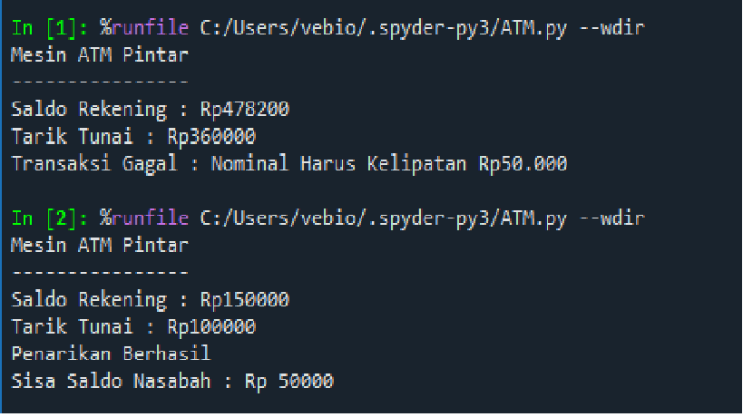

# 🏧 Mesin ATM Pintar (Simulasi Tarik Tunai Python v1.0)

Program berbasis konsol (CLI) yang mensimulasikan logika validasi mesin ATM saat melakukan transaksi tarik tunai menggunakan Python.

## Fitur validasi :
- **Cek Kecukupan Saldo** : Menolak transaksi otomatis jika nominal penarikan melebihi saldo pada rekening
- **Validasi Pecahan Uang** : Memastikan nominal penarikan adalah kelipatan **Rp50.000** menggunakan operator modulus ('%')
- **Limit Transaksi** : Membatasi penarikan maksimal sebesar **Rp2.500.000** per transaksi
- **Kalkulasi Sisa Saldo** : Menghitung dan menampilkan sisa saldo terbaru secara otomatis setelah transaki penarikan berhasil

## Tampilan Program

## Teknologi
- Python 3 (Spyder IDE)
